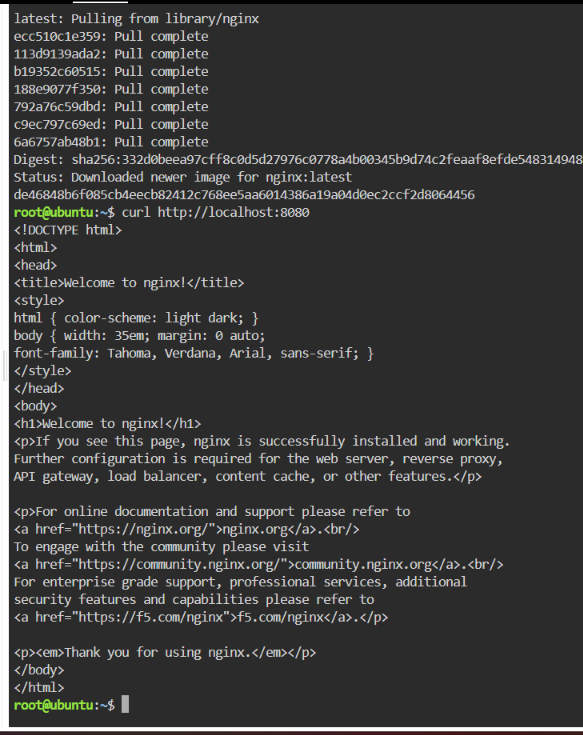
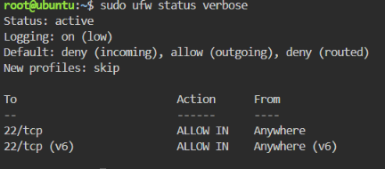
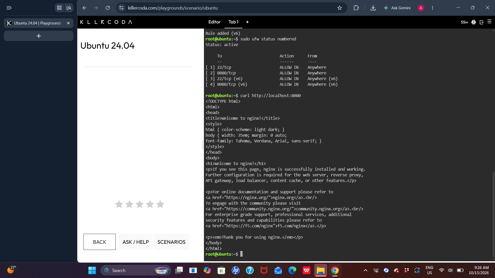

# Mission 8 Reflection: Cloud Security & Defense in Depth

## Written Reflection

### 1. Defense in Depth
A host-based firewall protects a server even if the physical network perimeter or cloud security groups are breached because it operates directly at the operating system kernel level. It acts as an independent, localized security boundary that filters incoming packets regardless of what happens upstream.

### 2. Managing Open Network Ports
Managing and minimizing open network ports is critical to reducing a server's attack surface. Every unmonitored open port provides potential entry points for automated port scanners, exploit scripts, and brute-force botnets seeking unpatched vulnerabilities.

### 3. Enterprise Database Security Risk
In a real enterprise environment, leaving a database port (such as 3306 for MySQL) open to the public internet is extremely dangerous. It exposes sensitive core database systems directly to credential stuffing attacks, SQL injection vectors, and unauthorized remote data extraction.

### 4. Perspective Shift on Cloud Hardening
Completing this mission highlighted how easily an unconfigured server can be discovered and targeted. Leaving default settings untouched creates an open vulnerability within minutes of deployment, demonstrating why proactive firewall setup is mandatory during initial provisioning.

### 5. Portfolio Progress
With eight completed laboratory missions, my GitHub Cloud Computing Portfolio reflects a clear trajectory from baseline deployments and multi-cloud configurations to infrastructure hardening and cloud security operations.

---

## Mission Evidence & Visual Verification

### Checkpoint 3: Vulnerable Nginx Application Deployment

### Checkpoint 4: UFW Enabled with Default Deny Policy

### Checkpoint 5: Granular Port Opening (8080/tcp) and Final Verification

